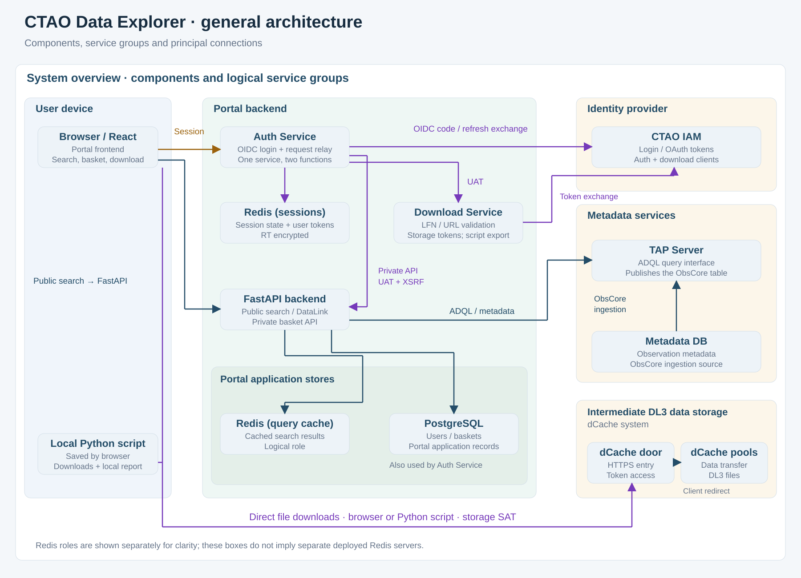

============
Architecture
============

The React frontend uses a Portal backend for authentication, observation searches,
basket management and download preparation. Data files are transferred directly
from the intermediate DL3 storage system to the user's browser or local script.

Component overview
------------------

   Logical components and service groups. Redis session and query-cache roles are
   shown separately; this does not imply separate deployed Redis servers.

:download:`Open the SVG <../diagrams/general-architecture.svg>` |
:download:`Download the Mermaid source <../diagrams/general-architecture.mmd>`

Components and responsibilities
-------------------------------

- **Frontend**: React (CRA), Axios, Bootstrap and map/chart widgets. It displays
  search results and baskets, and saves downloaded files or generated scripts.
- **Auth Service**: handles OpenID Connect login with CTAO IAM, server-side
  sessions and authenticated request forwarding. The relay is functionality of
  this service.
- **FastAPI backend**: provides public search and the authenticated basket API.
  PostgreSQL holds Portal application records, including users and baskets. Redis
  provides session storage and query caching.
- **Download Service**: maps file references to allowed HTTPS storage URLs and
  exchanges user tokens for temporary storage tokens. It returns file descriptors
  or a standalone Python download script.
- **Metadata services**: the TAP Server exposes an ObsCore table queried through
  TAP/ADQL. The Metadata DB supplies observation metadata for ObsCore ingestion.
  It is distinct from the Portal's PostgreSQL application database. The ingestion
  connection in the diagram is a logical view, not a deployment specification.
- **Intermediate DL3 storage**: a dCache system with an HTTPS door and data pools.
  Clients download directly from storage; the door may redirect them to a pool.

Authentication and download boundaries
--------------------------------------

The browser holds an opaque session identifier in the HttpOnly session cookie.
The Auth Service looks up the associated user access token in Redis and forwards
it to backend services when needed. User refresh tokens are encrypted in session
storage; client secrets remain on the server.

Public searches do not require a user bearer token. Private basket requests go
through the Auth Service; the backend checks identity and ownership and validates
XSRF cookie/header pairs on basket mutations.

Downloads use a separate storage bearer token obtained through IAM token exchange.
The browser receives it with the storage URL, or saves a script containing storage
URLs and temporary tokens. During execution, the script contacts storage directly
and does not call the Portal or refresh its tokens.

See :doc:`download-flows` for login, cookie, token and data-transfer sequences,
:doc:`bulk-download` for user instructions, and :doc:`standards` for the supported
interoperability standards. Job Preview submission is outside this overview.
