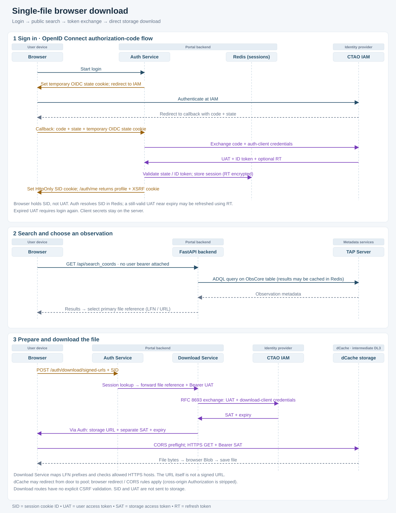
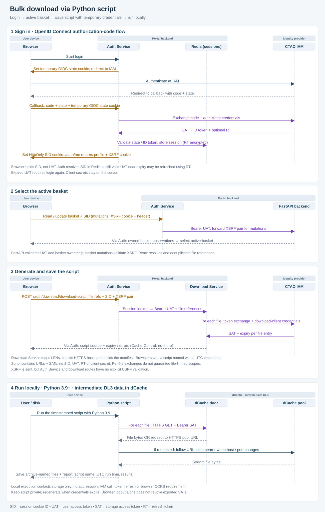

==============
Download flows
==============

These sequences complement the :doc:`architecture` overview. They show the normal
login and download paths, including the credentials passed between components.
**SID** is the session cookie identifier, **UAT** the user access token, **SAT** a
storage access token, and **RT** a refresh token. Auth Service includes the request
relay functionality.

Single-file browser download
----------------------------

The user signs in, searches for observations and selects a file. The Portal
prepares a storage URL and a separate bearer token; the browser downloads the file
directly from dCache.

   Single-file browser download, from login to saving the file.

:download:`Open the SVG <../diagrams/single-file-browser-download.svg>` |
:download:`Download the Mermaid source <../diagrams/single-file-browser-download.mmd>`

Bulk download via script
------------------------

The user selects a basket and saves a generated Python script. Its filename uses a
UTC timestamp. Running it downloads files under their archive basenames and writes
a report containing the executed script name, UTC execution time and file results.
See :doc:`bulk-download` for instructions and handling of filename conflicts.

   Bulk download preparation and independent execution on the user's computer.

:download:`Open the SVG <../diagrams/bulk-download.svg>` |
:download:`Download the Mermaid source <../diagrams/bulk-download.mmd>`

Security details to retain when changing these flows
----------------------------------------------------

- The saved script contains temporary storage tokens, but no session cookie,
  user access token, refresh token or client secret. Keep it private. Logging out
  of the Portal does not itself revoke exported storage tokens.
- A still-valid user access token near expiry may be refreshed by the Auth Service.
  An already-expired token requires login again for authenticated relay requests.
- The Python script follows bounded HTTPS redirects and removes the bearer header
  when host or port changes. Browser downloads follow browser redirect and CORS
  rules. Neither path sends the Portal session identifier or user token to storage.

Diagram maintenance
-------------------

Editable Mermaid sources and SVG assets are stored together in ``docs/diagrams``.
Sphinx includes the SVGs directly, so building the documentation requires no Mermaid
extension or browser-based diagram rendering. When a flow changes, update the
``.mmd`` source and the corresponding SVG together; see ``docs/diagrams/README.md``.
